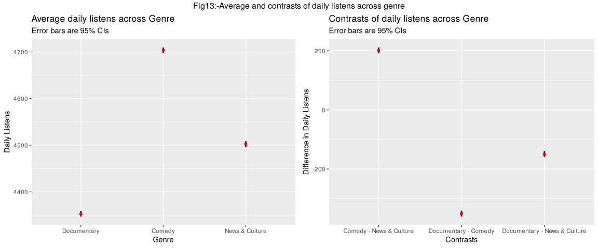
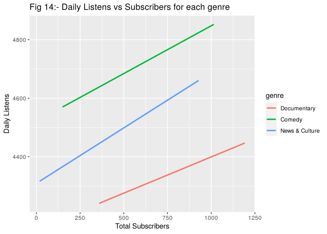
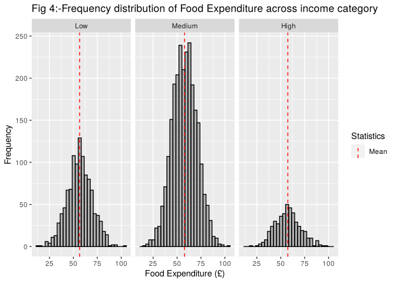

# 🛒🎧 Household Food Spending & Podcast Listens: Regression in R

**Tools:** R · tidyverse · ggplot2 · emmeans · car · Hmisc · R Markdown
**Context:** MSc Business Analytics, University of Warwick, Business Statistics assessment (2026)

This project uses regression in R on two datasets to find what actually drives people's behaviour:

1. **Household spending (4,000+ households).** What drives weekly food spending? Does the effect of alcohol spending depend on how much a household pays towards debt?
2. **Podcast audiences (5,400 podcasts).** Do review scores and review counts affect daily listens? How do genres compare? Does the value of a subscriber differ by genre?

📄 **[Read the full analysis with code and output →](analysis.md)**

---

## 💡 Key findings

### Podcasts: genre explains more than half the differences in listens



- **Genre alone explains 56% of the variation in daily listens (R² = 0.56).** Comedy averages **4,704** listens a day, News & Culture **4,503** and Documentary **4,353**. That puts Comedy **351 listens a day ahead** of Documentary and News & Culture **150 ahead**, and every pairwise difference is significant.
- **The number of reviews matters, but the average score doesn't.** Each extra review is linked to about **0.21 more daily listens** (95% CI 0.18 to 0.24). The average review score had no measurable effect (p = 0.67), probably because most podcasts score between 4 and 5, so there's little variation to explain listens.



- **A subscriber is worth more in some genres than others.** Each subscriber adds about **0.25** daily listens for Documentary, **0.33** for Comedy and **0.38** for News & Culture. Both differences from Documentary are significant (p = 0.012 and p < 0.001). Genre plus subscribers explains **61%** of the variation in daily listens.

**What this means for a podcast platform:** growing review counts and subscribers pays off more than chasing higher star ratings. Subscriber growth gives the biggest return for News & Culture shows.

### Household food spending: housing, alcohol and debt matter, household size doesn't

| Factor | Effect on weekly food spend | Significant? |
|---|---|---|
| Housing spend | **+£0.09** per extra £1 (95% CI 0.08 to 0.10) | ✅ p < 0.001 |
| Alcohol spend | **+£0.39** per extra £1 (95% CI 0.27 to 0.51) | ✅ p < 0.001 |
| Debt payments | **−£0.05** per extra £1 (95% CI −0.07 to −0.03) | ✅ p < 0.001 |
| Medium vs low income | **+£1.05** | ✅ p = 0.023 |
| High vs low income | +£0.63 | ❌ p = 0.38 |
| Household size | −£0.11 per person | ❌ p = 0.48 |
| Number of vehicles | +£0.36 per vehicle | ❌ p = 0.10 |

- **The effect of alcohol spending doesn't depend on debt.** The alcohol × debt interaction was not significant (p = 0.62).
- **The other variables still matter.** A model with only the alcohol × debt terms fitted far worse than the full model (F(5, 4074) = 140.2, p < 0.001).
- **These factors leave most of the variation unexplained.** The full model explains about **15% of the variation in food spending (R² = 0.15)**, so things not in the data, such as dietary habits or where people shop, matter a lot.



---

## 🔍 Approach

**Data cleaning**
- **Households:** I removed 14 records with missing Kids, HouseholdSize or Debt values, leaving 4,083. I kept households with high housing costs and zero debt payments, because those are plausible values rather than errors.
- **Podcasts:** I removed impossible values: one negative subscriber count and 23 average ratings above the 5-point scale, leaving 5,376. The 23 podcasts with zero reviews were left out of the review-score analysis only.

**Exploration:** I plotted the distribution of every variable, split by income category for the household data, with means marked to spot outliers.

**Multicollinearity:** I checked a correlation matrix (`Hmisc::rcorr`). Kids and HouseholdSize were highly correlated (r = 0.82), so I dropped Kids. VIF scores (`car::vif`) showed structural multicollinearity in the interaction models, so I **mean-centred** alcohol, debt and subscribers before interpreting them.

**Modelling:** I used multiple linear regression, with interaction terms to test whether one variable's effect depends on another. I compared the full and reduced models with ANOVA.

**Genre comparisons:** I calculated **estimated marginal means** and pairwise contrasts with 95% confidence intervals (`emmeans`).

---

## 📁 Repository structure

```
spending-podcast-regression/
├── README.md
├── analysis.Rmd                 # full analysis (R Markdown source)
├── analysis.md                  # knitted report: renders on GitHub with code, output and charts
├── analysis_files/              # charts used by analysis.md
├── data/
│   ├── household_expenditure.csv   # 4,097 households
│   └── podcast_listens.csv         # 5,400 podcasts
└── images/                      # charts used in this README
```

## ▶️ How to run

1. Install the packages in R:
   ```r
   install.packages(c("tidyverse", "Hmisc", "emmeans", "car", "gridExtra", "rmarkdown"))
   ```
2. Open `analysis.Rmd` in RStudio, with the repo folder as the working directory, and click **Knit**.

## ⚠️ Limitations

- **Both datasets are observational,** so the results show associations, not causes. Proving, for example, that more reviews *cause* more listens would need an experiment such as an A/B test.
- **The food model explains only about 15% of the variation,** so important drivers are missing from the data.
- **Review count and score explain only 3% of the variation in listens on their own (R² = 0.03),** much less than genre and subscribers.
