Household Food Spending and Podcast Listens: Regression in R
================
Joshua

- [Question 1](#question-1)
  - [Data Loading and cleaning](#data-loading-and-cleaning)
  - [Variable visualisations](#variable-visualisations)
  - [Statistical testing](#statistical-testing)
    - [Effect of variables upon food
      expenditure](#effect-of-variables-upon-food-expenditure)
    - [Effects of alcohol and whether the effect is the same across
      households with different debt
      payments](#effects-of-alcohol-and-whether-the-effect-is-the-same-across-households-with-different-debt-payments)
- [Question 2](#question-2)
  - [Data Loading and cleaning](#data-loading-and-cleaning-1)
  - [Variable visualisations](#variable-visualisations-1)
  - [Statistical testing](#statistical-testing-1)
    - [Do podcasts have more/fewer listens depending upon their average
      review scores and total number of
      reviews.](#do-podcasts-have-morefewer-listens-depending-upon-their-average-review-scores-and-total-number-of-reviews)
    - [Contrast the effect of listens across different
      genres.](#contrast-the-effect-of-listens-across-different-genres)
    - [What is the effect of subscribers upon the number of listens, and
      is this different across
      genres?](#what-is-the-effect-of-subscribers-upon-the-number-of-listens-and-is-this-different-across-genres)

``` r
knitr::opts_chunk$set(message = FALSE)
library(tidyverse)
library(Hmisc)
library(emmeans)
library(car)
library(gridExtra)
library(grid)
```

------------------------------------------------------------------------

------------------------------------------------------------------------

# Question 1

## Data Loading and cleaning

``` r
# Loading household_expenditure.csv and saving it as a tibble with its name as house

house <- read_csv("data/household_expenditure.csv")
```

The data dictionary of the loaded household_expenditure.csv file

| Variable        | Description                                    |
|-----------------|------------------------------------------------|
| Kids            | Number of kids in the household                |
| HouseholdSize   | Number of people in Household                  |
| Sex             | Gender of the survey respondent                |
| Vehicles        | Number of vehicles in the household            |
| Food            | Average food expenditure per week              |
| Housing         | Average amount spent on accommodation per week |
| Alcohol         | Average alcohol expenditure per week           |
| Debt            | Average amount spent on debt payment per week  |
| income_category | Income category of the household               |

``` r
# Checking the summary of the house tibble

summary(house)
```

    ##       Kids        HouseholdSize        Sex               Vehicles    
    ##  Min.   :0.0000   Min.   : 1.000   Length:4097        Min.   :0.000  
    ##  1st Qu.:0.0000   1st Qu.: 1.000   Class :character   1st Qu.:0.000  
    ##  Median :0.0000   Median : 2.000   Mode  :character   Median :1.000  
    ##  Mean   :0.5849   Mean   : 2.378                      Mean   :1.077  
    ##  3rd Qu.:1.0000   3rd Qu.: 3.000                      3rd Qu.:2.000  
    ##  Max.   :8.0000   Max.   :11.000                      Max.   :7.000  
    ##  NA's   :6        NA's   :6                                          
    ##       Food           Housing         Alcohol            Debt       
    ##  Min.   : 12.25   Min.   :155.9   Min.   : 7.429   Min.   :  0.00  
    ##  1st Qu.: 48.59   1st Qu.:281.8   1st Qu.:14.920   1st Qu.: 49.46  
    ##  Median : 57.27   Median :314.1   Median :17.012   Median : 59.85  
    ##  Mean   : 57.44   Mean   :319.2   Mean   :17.014   Mean   : 59.97  
    ##  3rd Qu.: 66.21   3rd Qu.:351.3   3rd Qu.:19.099   3rd Qu.: 70.78  
    ##  Max.   :103.54   Max.   :639.2   Max.   :27.658   Max.   :148.41  
    ##                                                    NA's   :8       
    ##  income_category   
    ##  Length:4097       
    ##  Class :character  
    ##  Mode  :character  
    ##                    
    ##                    
    ##                    
    ## 

The given dataset has about 4097 records. Upon checking the summary of
the house tibble. It is seen that Kids, HouseholdSize and Debt columns
have 6, 6 and 8 NA values recorded respectively. Some records are
missing more than one of these, so removing them drops 14 records, which
reduces the records to 4083.

``` r
house_clean <- house %>%
  filter(!is.na(Kids), !is.na(HouseholdSize), !is.na(Debt))

summary(house_clean)
```

    ##       Kids        HouseholdSize        Sex               Vehicles    
    ##  Min.   :0.0000   Min.   : 1.000   Length:4083        Min.   :0.000  
    ##  1st Qu.:0.0000   1st Qu.: 1.000   Class :character   1st Qu.:0.000  
    ##  Median :0.0000   Median : 2.000   Mode  :character   Median :1.000  
    ##  Mean   :0.5851   Mean   : 2.379                      Mean   :1.076  
    ##  3rd Qu.:1.0000   3rd Qu.: 3.000                      3rd Qu.:2.000  
    ##  Max.   :8.0000   Max.   :11.000                      Max.   :7.000  
    ##       Food           Housing         Alcohol            Debt       
    ##  Min.   : 12.25   Min.   :155.9   Min.   : 7.429   Min.   :  0.00  
    ##  1st Qu.: 48.60   1st Qu.:281.8   1st Qu.:14.921   1st Qu.: 49.47  
    ##  Median : 57.30   Median :314.1   Median :17.015   Median : 59.88  
    ##  Mean   : 57.46   Mean   :319.3   Mean   :17.018   Mean   : 59.98  
    ##  3rd Qu.: 66.20   3rd Qu.:351.4   3rd Qu.:19.099   3rd Qu.: 70.81  
    ##  Max.   :103.54   Max.   :639.2   Max.   :27.658   Max.   :148.41  
    ##  income_category   
    ##  Length:4083       
    ##  Class :character  
    ##  Mode  :character  
    ##                    
    ##                    
    ## 

``` r
# Checking the uniqueness of the data to see if there are case errors or misspellings

unique(house_clean$Sex)
```

    ## [1] "male"   "female"

``` r
unique(house_clean$income_category)
```

    ## [1] "High"   "Medium" "Low"

There are no issues in Sex and income_category variables.

``` r
# Converting Sex and income_category to categorical data

house_clean <- house_clean %>%
  mutate(Sex=factor(Sex),
         income_category=factor(income_category, c('Low', 'Medium', 'High')))
```

## Variable visualisations

The distribution of each variables is checked, along with its mean to
check out if there are any huge outliers.

``` r
mean_data <- house_clean %>%
  group_by(income_category) %>%
  summarise(food_mean = mean(Food),
            housing_mean = mean(Housing),
            alcohol_mean = mean(Alcohol),
            debt_mean = mean(Debt))
```

``` r
# Plotting frequency distribution of kids

ggplot(house_clean, aes(factor(Kids))) + 
  geom_bar(color='black', alpha=0.4)+
  facet_wrap(income_category~.) +
  labs(y="Frequency", x="Number of Kids", title = "Fig 1:-Frequency distribution of number of kids across income category")
```

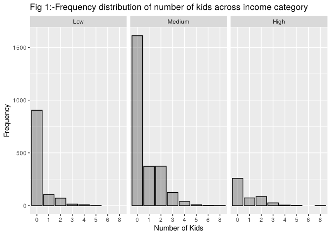<!-- -->

In figure 1, it can be seen that regardless of income category, most
households have 0 kids.

``` r
# Plotting frequency distribution of household size

ggplot(house_clean, aes(factor(HouseholdSize))) + 
  geom_bar(color='black', alpha=0.4)+
  facet_wrap(income_category~.) +
  labs(y="Frequency", x="Household Size", title = "Fig 2:-Frequency distribution of Household size across income category")
```

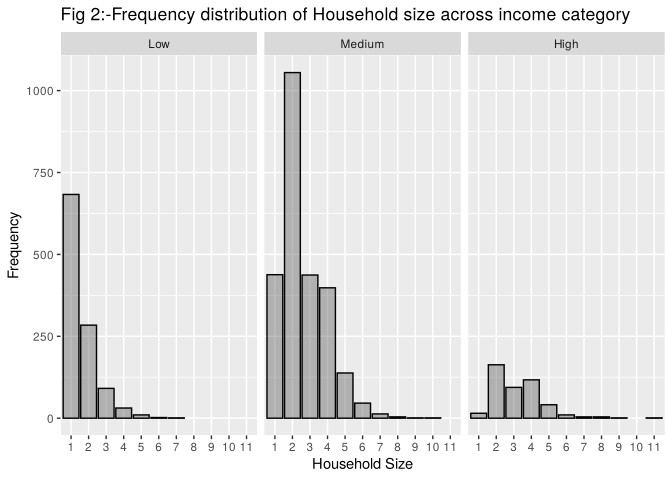<!-- -->

In figure 2,most households with low income have 1-2 people living, in
medium income household it is 1-3 people living and in large income
household 2-3 people are living.

``` r
# Plotting frequency distribution of number of vehicles

ggplot(house_clean, aes(factor(Vehicles))) + 
  geom_bar(color='black', alpha=0.4)+
  facet_wrap(income_category~.) +
  labs(y="Frequency", x="Number of Vehicles", title = "Fig 3:-Frequency distribution of number of vehicles across income category")
```

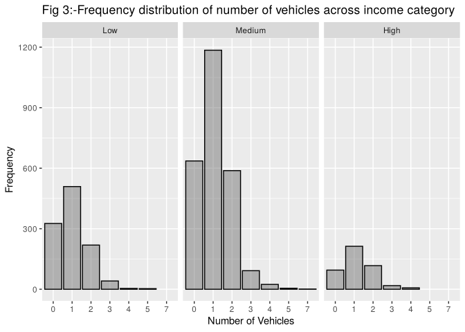<!-- -->

In figure 3, it can be seen that regardless of income category, most
households have 0-2 vehicles.

``` r
# Plotting frequency distribution of food expenditure

ggplot(house_clean, aes(Food)) + 
  geom_histogram(color='black', alpha=0.4) +
  facet_wrap(income_category~.) +
  geom_vline(data = mean_data, aes(xintercept = food_mean, linetype = "Mean"), color='red') + 
  scale_linetype_manual(
    name = 'Statistics', 
    values = c("Mean" = "dashed")
  ) +
  labs(y="Frequency", x="Food Expenditure (£)", title = "Fig 4:-Frequency distribution of Food Expenditure across income category")
```

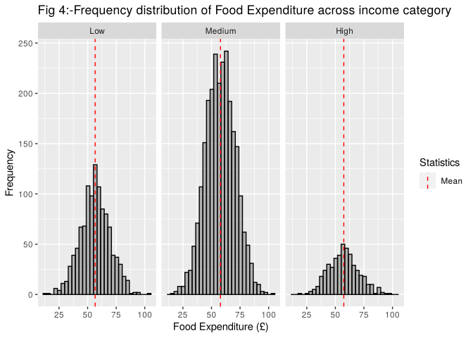<!-- -->

In figure 4, it can be seen that regardless of income, most households
spend around 50-75 pounds on food per week.

``` r
# Plotting frequency distribution of housing

ggplot(house_clean, aes(Housing)) + 
  geom_histogram(color='black', alpha=0.4)+
  facet_wrap(income_category~.) + 
  geom_vline(data = mean_data, aes(xintercept = housing_mean, linetype = "Mean"), color='red') + 
  scale_linetype_manual(
    name = 'Statistics', 
    values = c("Mean" = "dashed")
  ) +
  labs(y="Frequency", x="Housing Expenditure (£)", title = "Fig 5:-Frequency distribution of Housing Expenditure across income category")
```

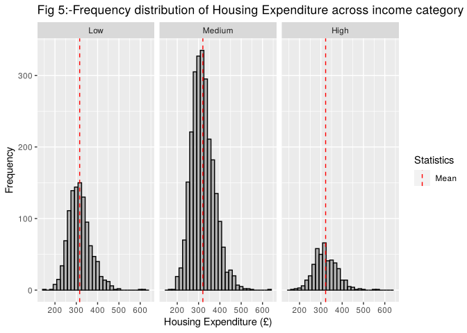<!-- -->

In figure 5, it can be seen that regardless income, most households
spend around 250-350 pounds per week on housing. Some households in low
and medium income have outlier households with spending over 600 pounds
on housing.These records are not removed as it is not too far from mean
and does not change the distribution.

``` r
# Plotting frequency distribution of alcohol 

ggplot(house_clean, aes(Alcohol)) + 
  geom_histogram(color='black', alpha=0.4)+
  facet_wrap(income_category~.) + 
  geom_vline(data = mean_data, aes(xintercept = alcohol_mean, linetype = "Mean"), color='red') + 
  scale_linetype_manual(
    name = 'Statistics', 
    values = c("Mean" = "dashed")
  ) +
  labs(y="Frequency", x="Alcohol Expenditure (£)", title = "Fig 6:- Frequency distribution of Alcohol Expenditure across income category")
```

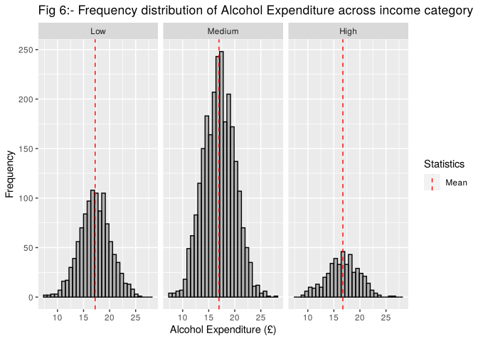<!-- -->

In figure 6, On average, the households spend around 15-20 pounds on
alcohol.

``` r
ggplot(house_clean, aes(Debt)) + 
  geom_histogram(color='black', alpha=0.4)+
  facet_wrap(income_category~.) + 
  geom_vline(data = mean_data, aes(xintercept = debt_mean, linetype = "Mean"), color='red') + 
  scale_linetype_manual(
    name = 'Statistics', 
    values = c("Mean" = "dashed")
  ) +
  labs(y="Frequency", x="Debt Payment (£)", title = "Fig 7:- Frequency distribution of Debt payment across income category")
```

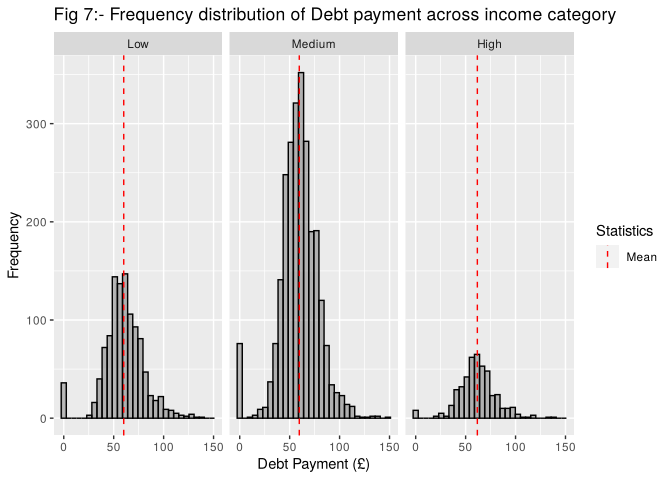<!-- -->

In figure 7, most households spend around 40-75 pounds per week paying
back their debts. Significant amount of households do not have debt
payments, which could mean do not have much debts to pay back, so they
are not removed.

## Statistical testing

The correlation is calculated for each variable to see if there are any
highly correlated data. If there are, it would lead to
multicollinearity.

``` r
# Calculating the correlation between variables

rcorr(as.matrix(select_if(house_clean, is.numeric)))
```

    ##                Kids HouseholdSize Vehicles  Food Housing Alcohol  Debt
    ## Kids           1.00          0.82     0.00 -0.01    0.01   -0.03 -0.01
    ## HouseholdSize  0.82          1.00     0.02  0.00    0.02   -0.03  0.00
    ## Vehicles       0.00          0.02     1.00  0.03    0.00   -0.01 -0.03
    ## Food          -0.01          0.00     0.03  1.00    0.37    0.07 -0.04
    ## Housing        0.01          0.02     0.00  0.37    1.00   -0.02  0.07
    ## Alcohol       -0.03         -0.03    -0.01  0.07   -0.02    1.00  0.13
    ## Debt          -0.01          0.00    -0.03 -0.04    0.07    0.13  1.00
    ## 
    ## n= 4083 
    ## 
    ## 
    ## P
    ##               Kids   HouseholdSize Vehicles Food   Housing Alcohol Debt  
    ## Kids                 0.0000        0.8920   0.4509 0.6758  0.1066  0.6967
    ## HouseholdSize 0.0000               0.2860   0.8153 0.3234  0.0398  0.9633
    ## Vehicles      0.8920 0.2860                 0.0941 0.9715  0.3493  0.0950
    ## Food          0.4509 0.8153        0.0941          0.0000  0.0000  0.0169
    ## Housing       0.6758 0.3234        0.9715   0.0000         0.1713  0.0000
    ## Alcohol       0.1066 0.0398        0.3493   0.0000 0.1713          0.0000
    ## Debt          0.6967 0.9633        0.0950   0.0169 0.0000  0.0000

Most data do not have high correlation with each other except for Kids
and HouseholdSize. This is expected since household size will include
kids also.

### Effect of variables upon food expenditure

To examine the effects of the number of kids, household size, income
category, alcohol expenditure, debt payment, housing payment and number
of vehicles on food expenditure, a multiple linear regression model is
fitted with these variables. Sex variable is not considered in this and
further analysis because it is the gender of the survey respondent. The
gender of the respondent does not normally change expenditure of
household, the size and number of vehicles. Kids is also removed, since
it is highly corelated with household size.

``` r
m.food <- lm(Food~ HouseholdSize+income_category+ Alcohol+ Debt+ Housing+Vehicles, data = house_clean)
summary(m.food)
```

    ## 
    ## Call:
    ## lm(formula = Food ~ HouseholdSize + income_category + Alcohol + 
    ##     Debt + Housing + Vehicles, data = house_clean)
    ## 
    ## Residuals:
    ##     Min      1Q  Median      3Q     Max 
    ## -42.215  -8.203  -0.085   8.097  39.775 
    ## 
    ## Coefficients:
    ##                        Estimate Std. Error t value Pr(>|t|)    
    ## (Intercept)           23.738854   1.665261  14.255  < 2e-16 ***
    ## HouseholdSize         -0.110201   0.156280  -0.705   0.4808    
    ## income_categoryMedium  1.047281   0.460230   2.276   0.0229 *  
    ## income_categoryHigh    0.625297   0.715961   0.873   0.3825    
    ## Alcohol                0.389192   0.062407   6.236 4.93e-10 ***
    ## Debt                  -0.049077   0.009717  -5.051 4.59e-07 ***
    ## Housing                0.091448   0.003484  26.248  < 2e-16 ***
    ## Vehicles               0.360329   0.216581   1.664   0.0962 .  
    ## ---
    ## Signif. codes:  0 '***' 0.001 '**' 0.01 '*' 0.05 '.' 0.1 ' ' 1
    ## 
    ## Residual standard error: 11.91 on 4075 degrees of freedom
    ## Multiple R-squared:  0.1533, Adjusted R-squared:  0.1518 
    ## F-statistic: 105.4 on 7 and 4075 DF,  p-value: < 2.2e-16

``` r
cbind(coef(m.food),confint(m.food))
```

    ##                                         2.5 %      97.5 %
    ## (Intercept)           23.73885376 20.47403318 27.00367434
    ## HouseholdSize         -0.11020061 -0.41659494  0.19619371
    ## income_categoryMedium  1.04728119  0.14497969  1.94958268
    ## income_categoryHigh    0.62529666 -0.77837861  2.02897193
    ## Alcohol                0.38919247  0.26684090  0.51154405
    ## Debt                  -0.04907665 -0.06812674 -0.03002656
    ## Housing                0.09144774  0.08461721  0.09827828
    ## Vehicles               0.36032936 -0.06428777  0.78494648

Upon running the model, it is seen that Alcohol, Housing and debt have
very high significance effect on food expenditure.

The housing expenditure is the most significant, showing that with a
pound extra spent on housing, the food expenditure will increase by 0.09
pounds ($b = 0.09$, CI = \[0.08, 0.09\], $t(4075)=26.25$, $p<0.001$).
While with 1 pound extra spent on alcohol will food expenditure by 0.38
pounds ($b = 0.38$, CI = \[0.26, 0.51\], $t(4075)=6.23$, $p<0.001$) and
with 1 pound extra spent on debt payment, will decrease the food
expenditure by 0.05 pounds ($b = -0.05$, CI = \[-0.06, -0.03\],
$t(4075)=-5.05$, $p<0.001$).

The household size and number of vehicles are not a significant
predictor for food expenditure. But in income category, the households
with medium category income is shown to be marginally significant with
1.04 pounds increase in food expenditure compared to low income category
households ($b = 1.05$, CI = \[0.15, 1.95\], $t(4075)=2.28$, $p=0.023$)
but households with high income category is not shown to be
significantly different from low income households.

### Effects of alcohol and whether the effect is the same across households with different debt payments

The interaction effect of Alcohol and Debt with effects of other
variables on food expenditure is examined using linear regression model

``` r
m.food.int <- lm(Food~ HouseholdSize+income_category+Alcohol*Debt+ Housing+Vehicles , data = house_clean)
summary(m.food.int)
```

    ## 
    ## Call:
    ## lm(formula = Food ~ HouseholdSize + income_category + Alcohol * 
    ##     Debt + Housing + Vehicles, data = house_clean)
    ## 
    ## Residuals:
    ##     Min      1Q  Median      3Q     Max 
    ## -42.183  -8.200  -0.068   8.096  39.761 
    ## 
    ## Coefficients:
    ##                        Estimate Std. Error t value Pr(>|t|)    
    ## (Intercept)           22.203764   3.542338   6.268 4.03e-10 ***
    ## HouseholdSize         -0.111509   0.156317  -0.713   0.4757    
    ## income_categoryMedium  1.048177   0.460276   2.277   0.0228 *  
    ## income_categoryHigh    0.630350   0.716102   0.880   0.3788    
    ## Alcohol                0.480544   0.196239   2.449   0.0144 *  
    ## Debt                  -0.022995   0.054000  -0.426   0.6702    
    ## Housing                0.091416   0.003485  26.232  < 2e-16 ***
    ## Vehicles               0.358822   0.216623   1.656   0.0977 .  
    ## Alcohol:Debt          -0.001527   0.003109  -0.491   0.6234    
    ## ---
    ## Signif. codes:  0 '***' 0.001 '**' 0.01 '*' 0.05 '.' 0.1 ' ' 1
    ## 
    ## Residual standard error: 11.91 on 4074 degrees of freedom
    ## Multiple R-squared:  0.1533, Adjusted R-squared:  0.1517 
    ## F-statistic: 92.22 on 8 and 4074 DF,  p-value: < 2.2e-16

``` r
vif(m.food.int)
```

    ##                      GVIF Df GVIF^(1/(2*Df))
    ## HouseholdSize    1.199143  1        1.095054
    ## income_category  1.208169  2        1.048412
    ## Alcohol         10.097361  1        3.177634
    ## Debt            31.638503  1        5.624811
    ## Housing          1.007247  1        1.003617
    ## Vehicles         1.004940  1        1.002467
    ## Alcohol:Debt    45.061826  1        6.712811

The VIF scores of Debt and Alcohol variables are very high, despite
having very less correlation. This is a structural multicollinearity. To
combat this alcohol and debt is normalised.

``` r
house_clean <- house_clean %>%
  mutate(nAlcohol=Alcohol-mean(Alcohol),
         nDebt=Debt-mean(Debt))

m.food.int <- lm(Food~ HouseholdSize+income_category+nAlcohol*nDebt+ Housing+Vehicles , data = house_clean)
summary(m.food.int)
```

    ## 
    ## Call:
    ## lm(formula = Food ~ HouseholdSize + income_category + nAlcohol * 
    ##     nDebt + Housing + Vehicles, data = house_clean)
    ## 
    ## Residuals:
    ##     Min      1Q  Median      3Q     Max 
    ## -42.183  -8.200  -0.068   8.096  39.761 
    ## 
    ## Coefficients:
    ##                        Estimate Std. Error t value Pr(>|t|)    
    ## (Intercept)           27.444002   1.204996  22.775  < 2e-16 ***
    ## HouseholdSize         -0.111509   0.156317  -0.713   0.4757    
    ## income_categoryMedium  1.048177   0.460276   2.277   0.0228 *  
    ## income_categoryHigh    0.630350   0.716102   0.880   0.3788    
    ## nAlcohol               0.388968   0.062414   6.232 5.07e-10 ***
    ## nDebt                 -0.048977   0.009720  -5.039 4.88e-07 ***
    ## Housing                0.091416   0.003485  26.232  < 2e-16 ***
    ## Vehicles               0.358822   0.216623   1.656   0.0977 .  
    ## nAlcohol:nDebt        -0.001527   0.003109  -0.491   0.6234    
    ## ---
    ## Signif. codes:  0 '***' 0.001 '**' 0.01 '*' 0.05 '.' 0.1 ' ' 1
    ## 
    ## Residual standard error: 11.91 on 4074 degrees of freedom
    ## Multiple R-squared:  0.1533, Adjusted R-squared:  0.1517 
    ## F-statistic: 92.22 on 8 and 4074 DF,  p-value: < 2.2e-16

``` r
vif(m.food.int)
```

    ##                     GVIF Df GVIF^(1/(2*Df))
    ## HouseholdSize   1.199143  1        1.095054
    ## income_category 1.208169  2        1.048412
    ## nAlcohol        1.021424  1        1.010655
    ## nDebt           1.025040  1        1.012443
    ## Housing         1.007247  1        1.003617
    ## Vehicles        1.004940  1        1.002467
    ## nAlcohol:nDebt  1.001376  1        1.000688

The VIF scores low, so the model is good.

``` r
cbind(coef(m.food.int),confint(m.food.int))
```

    ##                                           2.5 %       97.5 %
    ## (Intercept)           27.444001542 25.081550894 29.806452190
    ## HouseholdSize         -0.111509021 -0.417976435  0.194958393
    ## income_categoryMedium  1.048177017  0.145784335  1.950569700
    ## income_categoryHigh    0.630349930 -0.773601170  2.034301029
    ## nAlcohol               0.388968423  0.266602174  0.511334672
    ## nDebt                 -0.048977438 -0.068033424 -0.029921452
    ## Housing                0.091416030  0.084583683  0.098248378
    ## Vehicles               0.358821528 -0.065877851  0.783520908
    ## nAlcohol:nDebt        -0.001526722 -0.007622821  0.004569376

Upon seeing the interactions between alcohol expenditure and debt
payments and effects of other variables on food expenditure, it is shown
that the interaction is not significant ($b = -0.0015$, CI = \[-0.008,
0.005\], $t(4074)=-0.49$, $p=0.62$) . This indicates that the effect of
alcohol expenditure on food expenditure does not significantly differ
across different debt payment levels.

Now, the interaction effect of alcohol expenditure and debt payment on
food expenditure without the effects of other variables, to see if
significance changes without other variables.

``` r
m.food.int2 <- lm(Food~ nAlcohol*nDebt , data = house_clean)
summary(m.food.int2)
```

    ## 
    ## Call:
    ## lm(formula = Food ~ nAlcohol * nDebt, data = house_clean)
    ## 
    ## Residuals:
    ##     Min      1Q  Median      3Q     Max 
    ## -43.281  -8.717  -0.098   8.783  44.448 
    ## 
    ## Coefficients:
    ##                 Estimate Std. Error t value Pr(>|t|)    
    ## (Intercept)    57.480895   0.203401 282.599  < 2e-16 ***
    ## nAlcohol        0.334216   0.067403   4.958 7.39e-07 ***
    ## nDebt          -0.031518   0.010480  -3.007  0.00265 ** 
    ## nAlcohol:nDebt -0.003098   0.003363  -0.921  0.35690    
    ## ---
    ## Signif. codes:  0 '***' 0.001 '**' 0.01 '*' 0.05 '.' 0.1 ' ' 1
    ## 
    ## Residual standard error: 12.89 on 4079 degrees of freedom
    ## Multiple R-squared:  0.007601,   Adjusted R-squared:  0.006871 
    ## F-statistic: 10.41 on 3 and 4079 DF,  p-value: 8.001e-07

``` r
cbind(coef(m.food.int2),confint(m.food.int2))
```

    ##                                    2.5 %       97.5 %
    ## (Intercept)    57.480894823 57.082117895 57.879671751
    ## nAlcohol        0.334215684  0.202068988  0.466362379
    ## nDebt          -0.031517905 -0.052064447 -0.010971363
    ## nAlcohol:nDebt -0.003098364 -0.009691113  0.003494386

The significance of the interaction in this model has increased
($b = -0.003$, CI = \[-0.010, 0.003\], $t(4079)=-0.92$, $p=0.36$)
compared to previous model, but it still doesn’t reject the null
hypothesis. On the surface this model might be better but the
F-statistic score is much lower.

The anova model is now used to see which model is better.

``` r
anova(m.food.int, m.food.int2)
```

    ## Analysis of Variance Table
    ## 
    ## Model 1: Food ~ HouseholdSize + income_category + nAlcohol * nDebt + Housing + 
    ##     Vehicles
    ## Model 2: Food ~ nAlcohol * nDebt
    ##   Res.Df    RSS Df Sum of Sq      F    Pr(>F)    
    ## 1   4074 578344                                  
    ## 2   4079 677889 -5    -99545 140.24 < 2.2e-16 ***
    ## ---
    ## Signif. codes:  0 '***' 0.001 '**' 0.01 '*' 0.05 '.' 0.1 ' ' 1

The result of the anova model is very significant and it shows Model 1,
which includes other variables, fits much better compared to Model 2
with just interaction effect between alcohol and debt variables
($F(5,4074)=140.24$, $p<0.001$). This shows that we cannot ignore other
variables like housing expenditure, to gain understanding of food
expenditure even if we are just seeing interaction effect of the said
variables.

------------------------------------------------------------------------

# Question 2

## Data Loading and cleaning

``` r
# Loading the podcast_listens.csv and saving it as a tibble with its name as podcast

podcast <- read_csv("data/podcast_listens.csv")
```

The data dictionary of the loaded podcast_listens.csv file.

| Variable      | Description                                      |
|---------------|--------------------------------------------------|
| Platform      | The platform where the podcast is being streamed |
| genre         | Genre of podcast                                 |
| avg.review    | Average review rating of the podcast             |
| daily.listens | Average daily listens                            |
| total.reviews | Number of reviews the podcast has                |
| subscribers   | Subscriber count of the podcast                  |

``` r
# Checking the summary of the podcast tibble

summary(podcast)
```

    ##    Platform            genre             avg.review      daily.listens 
    ##  Length:5400        Length:5400        Min.   :  0.000   Min.   :3951  
    ##  Class :character   Class :character   1st Qu.:  4.140   1st Qu.:4372  
    ##  Mode  :character   Mode  :character   Median :  4.440   Median :4507  
    ##                                        Mean   :  4.747   Mean   :4520  
    ##                                        3rd Qu.:  4.660   3rd Qu.:4663  
    ##                                        Max.   :100.000   Max.   :5188  
    ##  total.reviews     subscribers    
    ##  Min.   :   0.0   Min.   :  -2.0  
    ##  1st Qu.: 849.0   1st Qu.: 492.5  
    ##  Median : 958.0   Median : 614.2  
    ##  Mean   : 951.5   Mean   : 627.8  
    ##  3rd Qu.:1064.0   3rd Qu.: 760.9  
    ##  Max.   :1506.0   Max.   :1191.9

The podcast dataset has about 5400 records of data. From the summary, it
is seen that the subscribers data has records which have less than 0
subscribers and is in decimals. This is not possible since this is not
average and total count cannot be less than zero. It is also seen that
avg.review has readings with 100, while majority of data are less than 5
as we can see from quartiles. This means the rating score is out of 5.

So the subscribers less than 0 and avg.reviews over 5 are removed. Also
the subscribers are rounded and Platform and genre are made into
categorical.

``` r
podcast_clean <- podcast %>%
  mutate(subscribers=round(subscribers),
         Platform=factor(Platform),
         genre=factor(genre, c("Documentary","Comedy","News & Culture"))) %>%
  filter(subscribers>=0) %>% 
  filter(avg.review<=5) 

summary(podcast_clean)
```

    ##            Platform               genre        avg.review   daily.listens 
    ##  Apple Podcasts:3881   Documentary   :1789   Min.   :0.00   Min.   :3951  
    ##  BBC Sounds    : 160   Comedy        :1794   1st Qu.:4.14   1st Qu.:4372  
    ##  Spotify       : 831   News & Culture:1793   Median :4.44   Median :4508  
    ##  YouTube       : 504                         Mean   :4.34   Mean   :4520  
    ##                                              3rd Qu.:4.66   3rd Qu.:4664  
    ##                                              Max.   :5.00   Max.   :5188  
    ##  total.reviews     subscribers    
    ##  Min.   :   0.0   Min.   :  19.0  
    ##  1st Qu.: 850.0   1st Qu.: 492.0  
    ##  Median : 958.0   Median : 614.0  
    ##  Mean   : 955.5   Mean   : 627.7  
    ##  3rd Qu.:1065.0   3rd Qu.: 761.0  
    ##  Max.   :1506.0   Max.   :1192.0

## Variable visualisations

The distribution of each variables are checked, along with its mean to
check out any huge outliers.

``` r
# Checking the uniqueness of the data to see there are case errors or misspellings

unique(podcast_clean$Platform)
```

    ## [1] Apple Podcasts Spotify        YouTube        BBC Sounds    
    ## Levels: Apple Podcasts BBC Sounds Spotify YouTube

``` r
unique(podcast_clean$genre)
```

    ## [1] Comedy         News & Culture Documentary   
    ## Levels: Documentary Comedy News & Culture

There are no issues in platform and genre columns

``` r
#calculating the mean for the plots

mean_pod_data <- podcast_clean  %>%
  summarise(avgreview_mean = mean(avg.review),
            listens_mean = mean(daily.listens),
            totreview_mean = mean(total.reviews),
            subs_mean = mean(subscribers))
```

``` r
# Plotting frequency distribution of average review

ggplot(podcast_clean, aes(avg.review))+
  geom_histogram( bins=30, color='black', alpha=0.4) +  
  geom_vline(data = mean_pod_data, aes(xintercept = avgreview_mean, linetype = "Mean"), color='red') + 
  scale_linetype_manual(
    name = 'Statistics', 
    values = c("Mean" = "dashed")
  )+
  labs(y="Frequency", x="Average review rating", title = "Fig 8:- Frequency distribution of Average review rating ")
```

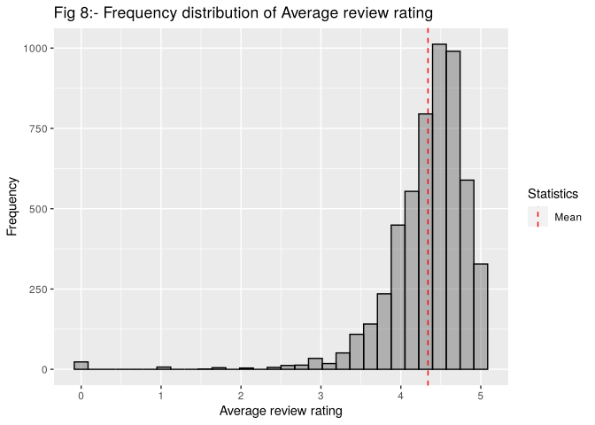<!-- -->

In figure 8, it can be seen that on average, the review ratings of
podcast is around 4.3. There are also couple of podcast with zero score.
On the surface, this is not an issue, but will be investigated further
latter.

``` r
# Plotting frequency distribution of daily listens

ggplot(podcast_clean, aes(daily.listens))+
  geom_histogram(color='black', alpha=0.4, bins=40) + 
  geom_vline(data = mean_pod_data, aes(xintercept = listens_mean, linetype = "Mean"), color='red') + 
  scale_linetype_manual(
    name = 'Statistics', 
    values = c("Mean" = "dashed")
  ) +
  labs(y="Frequency", x="Average daily listens", title = "Fig 9:-Frequency distribution of average daily listens")
```

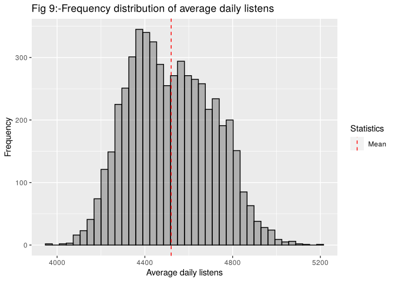<!-- -->

In figure 9, it can be seen that on average, the daily listens of
podcast is around 4500.

``` r
# Plotting frequency distribution of total reviews

ggplot(podcast_clean, aes(total.reviews))+
  geom_histogram(color='black', alpha=0.4) +
  geom_vline(data = mean_pod_data, aes(xintercept = totreview_mean, linetype = "Mean"), color='red') + 
  scale_linetype_manual(
    name = 'Statistics', 
    values = c("Mean" = "dashed")
  ) +
  labs(y="Frequency", x="Total Reviews", title = "Fig 10:-Frequency distribution of total review")
```

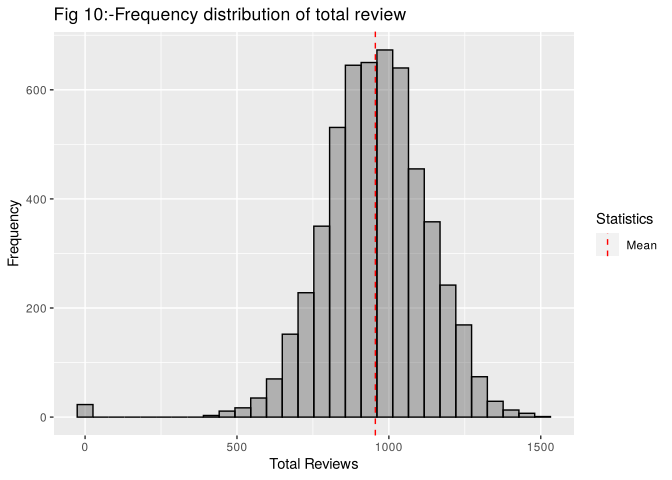<!-- -->

In figure 10, on average a podcast has about 900 reviews. It is also
seen that there is a significant outlier for podcast with no reviews.
This will be investigated further later on along with avg.reviews.

``` r
# Plotting frequency distribution of total subscribers

ggplot(podcast_clean, aes(subscribers))+
  geom_histogram(color='black', alpha=0.4) +
  geom_vline(data = mean_pod_data, aes(xintercept = subs_mean, linetype = "Mean"), color='red') + 
  scale_linetype_manual(
    name = 'Statistics', 
    values = c("Mean" = "dashed")
  ) + 
  labs(y="Frequency", x="Total Subscribers", title = "Fig 11:- Frequency distribution of Total Subscribers ")
```

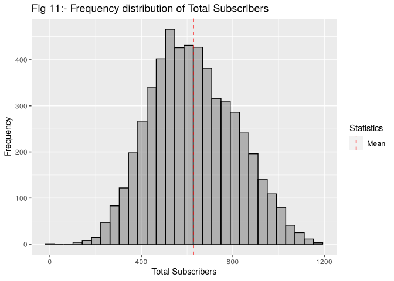<!-- -->

In figure 11, on average, a podcast has around 600 subscribers.

``` r
# Plotting average review vs total reviews

ggplot(podcast_clean, aes(total.reviews, avg.review)) +  geom_point() + 
  labs(y="Average Review Score", x="Total Reviews", title = "Fig 12:- Average Review Score vs Number of Reviews")
```

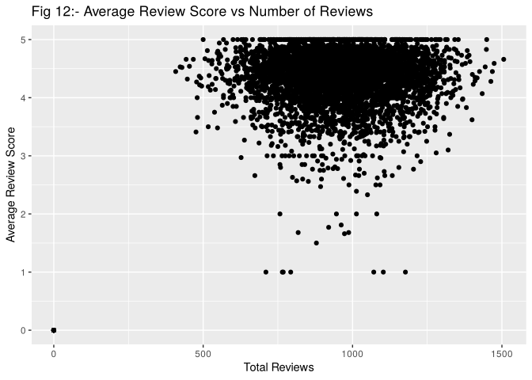<!-- -->

In Figure 12, it is seen that podcast with 0 reviews and score is huge
outlier. These podcast will be removed only in upcoming analysis on
effect of average review score and total reviews on daily listens and
not on other analysis, because it still contains other important
information.

## Statistical testing

The correlation is calculated for each variable to see if there are any
highly correlated data. If there are, it would lead to
multicollinearity.

``` r
rcorr(as.matrix(select_if(podcast_clean, is.numeric)))
```

    ##               avg.review daily.listens total.reviews subscribers
    ## avg.review          1.00          0.00          0.20        0.01
    ## daily.listens       0.00          1.00          0.17       -0.23
    ## total.reviews       0.20          0.17          1.00        0.07
    ## subscribers         0.01         -0.23          0.07        1.00
    ## 
    ## n= 5376 
    ## 
    ## 
    ## P
    ##               avg.review daily.listens total.reviews subscribers
    ## avg.review               0.9185        0.0000        0.3815     
    ## daily.listens 0.9185                   0.0000        0.0000     
    ## total.reviews 0.0000     0.0000                      0.0000     
    ## subscribers   0.3815     0.0000        0.0000

There is very little correlation each variable. And the correlations of
avg.review and subscribers and daily.listens and avg.review correlation
very close to zero. Which means they have almost no relation with each
other.

### Do podcasts have more/fewer listens depending upon their average review scores and total number of reviews.

To examine the effects of average review and total reviews on daily
listens, a multiple linear regression model is fitted with these
variables. As stated above, the records with 0 total reviews and average
reviews are filtered out, as it is a huge outlier.

``` r
podcast.new <- podcast_clean%>% 
  filter(total.reviews>0) %>%
  filter(avg.review>0)


m.listen <- lm(daily.listens~avg.review + total.reviews, data=podcast.new)

summary(m.listen)
```

    ## 
    ## Call:
    ## lm(formula = daily.listens ~ avg.review + total.reviews, data = podcast.new)
    ## 
    ## Residuals:
    ##     Min      1Q  Median      3Q     Max 
    ## -547.18 -149.98   -9.27  146.83  618.03 
    ## 
    ## Coefficients:
    ##                 Estimate Std. Error t value Pr(>|t|)    
    ## (Intercept)   4327.04014   29.47180 146.820   <2e-16 ***
    ## avg.review      -2.45362    5.72994  -0.428    0.669    
    ## total.reviews    0.21223    0.01612  13.166   <2e-16 ***
    ## ---
    ## Signif. codes:  0 '***' 0.001 '**' 0.01 '*' 0.05 '.' 0.1 ' ' 1
    ## 
    ## Residual standard error: 188.4 on 5350 degrees of freedom
    ## Multiple R-squared:  0.03141,    Adjusted R-squared:  0.03105 
    ## F-statistic: 86.75 on 2 and 5350 DF,  p-value: < 2.2e-16

``` r
cbind(coef(m.listen),confint(m.listen))
```

    ##                                   2.5 %       97.5 %
    ## (Intercept)   4327.0401419 4269.2633968 4384.8168870
    ## avg.review      -2.4536152  -13.6866354    8.7794051
    ## total.reviews    0.2122302    0.1806281    0.2438324

On running the multiple regression model on average review score and
total reviews, it is seen that total reviews of the podcast is shown to
have significant effect on average daily listens, with a unit increase
in total reviews will increase the listens by 0.21 per day ($b = 0.21$,
CI = \[0.18, 0.24\], $t(5350)=13.16$, $p<0.001$).

Whereas, average review score is not have a significant effect on daily
listens, which indicates that review scores doesn’t significantly change
daily listens. This relation can also be seen in correlation matrix,
which is very close to zero.

### Contrast the effect of listens across different genres.

To see daily listens on each genre, a linear regression model with them.

``` r
m.listen.genre <- lm(daily.listens~genre, data=podcast_clean)
summary(m.listen.genre)
```

    ## 
    ## Call:
    ## lm(formula = daily.listens ~ genre, data = podcast_clean)
    ## 
    ## Residuals:
    ##     Min      1Q  Median      3Q     Max 
    ## -551.28  -82.33    1.27   81.20  562.55 
    ## 
    ## Coefficients:
    ##                     Estimate Std. Error t value Pr(>|t|)    
    ## (Intercept)         4352.883      2.990 1455.81   <2e-16 ***
    ## genreComedy          350.881      4.226   83.04   <2e-16 ***
    ## genreNews & Culture  149.764      4.226   35.44   <2e-16 ***
    ## ---
    ## Signif. codes:  0 '***' 0.001 '**' 0.01 '*' 0.05 '.' 0.1 ' ' 1
    ## 
    ## Residual standard error: 126.5 on 5373 degrees of freedom
    ## Multiple R-squared:  0.5638, Adjusted R-squared:  0.5637 
    ## F-statistic:  3473 on 2 and 5373 DF,  p-value: < 2.2e-16

``` r
cbind(coef(m.listen.genre),confint(m.listen.genre))
```

    ##                                   2.5 %    97.5 %
    ## (Intercept)         4352.8831 4347.0215 4358.7448
    ## genreComedy          350.8807  342.5969  359.1646
    ## genreNews & Culture  149.7636  141.4786  158.0486

Here the documentary genre is used as reference category for the model.

From the regression output, it can be seen that Comedy has on average
351 more views than Documentary ($b = 351$, CI = \[342.60, 359.16\],
$t(5373)=83.04$, $p<0.001$), while News and Culture genre has on average
has 150 more views than Documentary ($b = 149.76$, CI = \[141.48,
158.05\], $t(5373)=35.44$, $p<0.001$).

``` r
(m.listen.genre.emm <- emmeans(m.listen.genre, ~genre))
```

    ##  genre          emmean    SE   df lower.CL upper.CL
    ##  Documentary      4353 2.990 5373     4347     4359
    ##  Comedy           4704 2.986 5373     4698     4710
    ##  News & Culture   4503 2.987 5373     4497     4509
    ## 
    ## Confidence level used: 0.95

``` r
(  m.listen.genre.pairs <- confint(pairs(m.listen.genre.emm))  )
```

    ##  contrast                     estimate   SE   df lower.CL upper.CL
    ##  Documentary - Comedy             -351 4.23 5373     -361     -341
    ##  Documentary - News & Culture     -150 4.23 5373     -160     -140
    ##  Comedy - News & Culture           201 4.22 5373      191      211
    ## 
    ## Confidence level used: 0.95 
    ## Conf-level adjustment: tukey method for comparing a family of 3 estimates

``` r
emm_pod <- ggplot(summary(m.listen.genre.emm), aes(x=genre,y=emmean,ymin=lower.CL, ymax=upper.CL)) + geom_linerange(linewidth=1) + geom_point(color="red") + labs(x="Genre", y="Daily Listens", title="Average daily listens across Genre ",subtitle="Error bars are 95% CIs")

cont_pod <- ggplot(m.listen.genre.pairs, aes(x=contrast, y=estimate, ymin=lower.CL, ymax=upper.CL)) + geom_linerange(linewidth=1) + geom_point(color="red") + labs(x="Contrasts", y="Difference in Daily Listens", title="Contrasts of daily listens across Genre ",subtitle="Error bars are 95% CIs")

grid.arrange(emm_pod, cont_pod, ncol=2, top = textGrob("Fig13:-Average and contrasts of daily listens across genre"))
```

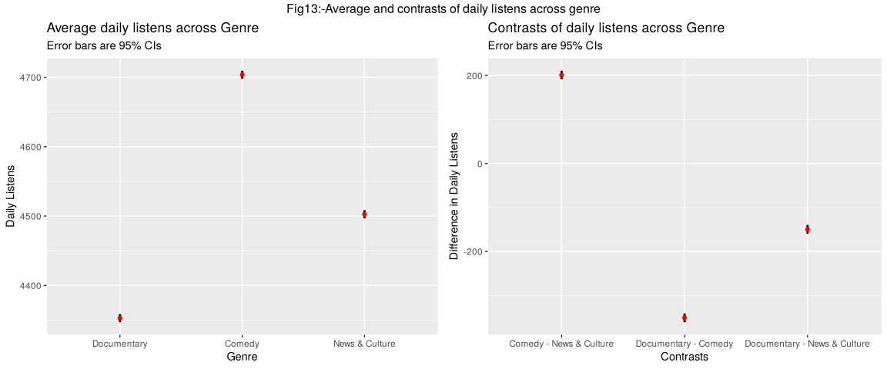<!-- -->

The left plot of Figure 13 shows the mean daily listens for each genre.
Comedy has the most daily listens, followed by News&Culture. The
documentary genre has the lowest listens. The right plot shows the
estimated differences in daily listens for each sets of genre.

### What is the effect of subscribers upon the number of listens, and is this different across genres?

To examine the effects of subscribers on the number of listens for each
genre, a multiple linear regression model is fitted with the interaction
of subscribers and genre.

``` r
m.subscribers <- lm(daily.listens~subscribers*genre, data=podcast_clean)
summary(m.subscribers)
```

    ## 
    ## Call:
    ## lm(formula = daily.listens ~ subscribers * genre, data = podcast_clean)
    ## 
    ## Residuals:
    ##     Min      1Q  Median      3Q     Max 
    ## -574.75  -76.15    0.84   76.12  498.55 
    ## 
    ## Coefficients:
    ##                                  Estimate Std. Error t value Pr(>|t|)    
    ## (Intercept)                     4.152e+03  1.805e+01 230.017  < 2e-16 ***
    ## subscribers                     2.475e-01  2.193e-02  11.285  < 2e-16 ***
    ## genreComedy                     3.693e+02  2.210e+01  16.709  < 2e-16 ***
    ## genreNews & Culture             1.574e+02  2.109e+01   7.464 9.76e-14 ***
    ## subscribers:genreComedy         7.897e-02  3.123e-02   2.529   0.0115 *  
    ## subscribers:genreNews & Culture 1.313e-01  3.010e-02   4.362 1.31e-05 ***
    ## ---
    ## Signif. codes:  0 '***' 0.001 '**' 0.01 '*' 0.05 '.' 0.1 ' ' 1
    ## 
    ## Residual standard error: 119.2 on 5370 degrees of freedom
    ## Multiple R-squared:  0.6129, Adjusted R-squared:  0.6125 
    ## F-statistic:  1700 on 5 and 5370 DF,  p-value: < 2.2e-16

``` r
vif(m.subscribers)
```

    ##                        GVIF Df GVIF^(1/(2*Df))
    ## subscribers         6.29033  1        2.508053
    ## genre             589.64419  2        4.927737
    ## subscribers:genre 355.72693  2        4.342894

The VIF scores of subscribers is very high when interacting with genre,
despite having very less correlation. This is a structural
multicollinearity. To combat this subscribers is normalised.

``` r
podcast_clean <- podcast_clean %>%
  mutate(nsubscribers=subscribers-mean(subscribers))

m.subscribers <- lm(daily.listens~nsubscribers*genre, data=podcast_clean)
summary(m.subscribers)
```

    ## 
    ## Call:
    ## lm(formula = daily.listens ~ nsubscribers * genre, data = podcast_clean)
    ## 
    ## Residuals:
    ##     Min      1Q  Median      3Q     Max 
    ## -574.75  -76.15    0.84   76.12  498.55 
    ## 
    ## Coefficients:
    ##                                   Estimate Std. Error t value Pr(>|t|)    
    ## (Intercept)                      4.307e+03  4.943e+00 871.411  < 2e-16 ***
    ## nsubscribers                     2.475e-01  2.193e-02  11.285  < 2e-16 ***
    ## genreComedy                      4.189e+02  5.885e+00  71.183  < 2e-16 ***
    ## genreNews & Culture              2.398e+02  6.175e+00  38.830  < 2e-16 ***
    ## nsubscribers:genreComedy         7.897e-02  3.123e-02   2.529   0.0115 *  
    ## nsubscribers:genreNews & Culture 1.313e-01  3.010e-02   4.362 1.31e-05 ***
    ## ---
    ## Signif. codes:  0 '***' 0.001 '**' 0.01 '*' 0.05 '.' 0.1 ' ' 1
    ## 
    ## Residual standard error: 119.2 on 5370 degrees of freedom
    ## Multiple R-squared:  0.6129, Adjusted R-squared:  0.6125 
    ## F-statistic:  1700 on 5 and 5370 DF,  p-value: < 2.2e-16

``` r
vif(m.subscribers)
```

    ##                        GVIF Df GVIF^(1/(2*Df))
    ## nsubscribers       6.290330  1        2.508053
    ## genre              3.841699  2        1.400009
    ## nsubscribers:genre 5.432250  2        1.526669

The VIF score is less than 10, which is good now.

``` r
cbind(coef(m.subscribers),confint(m.subscribers))
```

    ##                                                      2.5 %       97.5 %
    ## (Intercept)                      4.307057e+03 4.297367e+03 4316.7464675
    ## nsubscribers                     2.475072e-01 2.045102e-01    0.2905042
    ## genreComedy                      4.189106e+02 4.073736e+02  430.4475603
    ## genreNews & Culture              2.397907e+02 2.276844e+02  251.8969815
    ## nsubscribers:genreComedy         7.897302e-02 1.774391e-02    0.1402021
    ## nsubscribers:genreNews & Culture 1.312788e-01 7.227483e-02    0.1902828

The total subscribers have a significant positive effect on daily
listens, with every new subscriber there will be 0.24 increase daily
listens when seeing baseline documentary category ($b = 0.24$, CI =
\[0.2, 0.29\], $t(5370)=11.28$, $p<0.001$).

The model also shows that there is significant change in listens when
comparing with other genres. For comedy genre, for every new subscriber
there will be 0.32 increase in daily listens (0.08 increase from
documentary genre) ($b = 0.08$, CI = \[0.02, 0.14\], $t(5370)=2.53$,
$p=0.012$). Whereas for News&Culture genre, for every new subscriber,
there will be 0.38 increase in daily listens ($b = 0.13$, CI = \[0.07,
0.19\], $t(5370)=4.362$, $p<0.001$).

The effects of subscribers on daily listens for each genre can be seen
in below figure.

``` r
ggplot(podcast_clean, aes(x=subscribers, y=daily.listens, colour = genre)) +  geom_smooth(method = lm, se=FALSE) + 
  labs(y="Daily Listens", x="Total Subscribers", title = "Fig 14:- Daily Listens vs Subscribers for each genre")
```

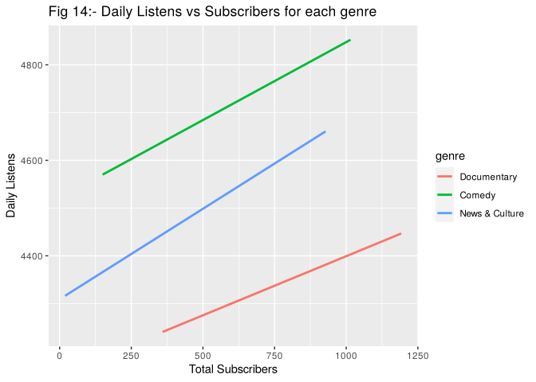<!-- -->

In figure 14, it can be seen that there is positive relation between
susbcribers and daily listens for all 3 genres.The comedy genre is the
most popular, with having more daily listens for the same amount if
subscribers compared to other genre. At 500 subscribers, the comedy
genre gets around 4700 daily listens, News & Culture gets around 4500
daily listens, and Documentary gets around 4300 daily listens. Since
each extra subscriber adds more listens for News & Culture than for
Comedy, News & Culture could eventually catch up with Comedy at very
high subscriber counts, although this would be extrapolating beyond the
data.

------------------------------------------------------------------------
